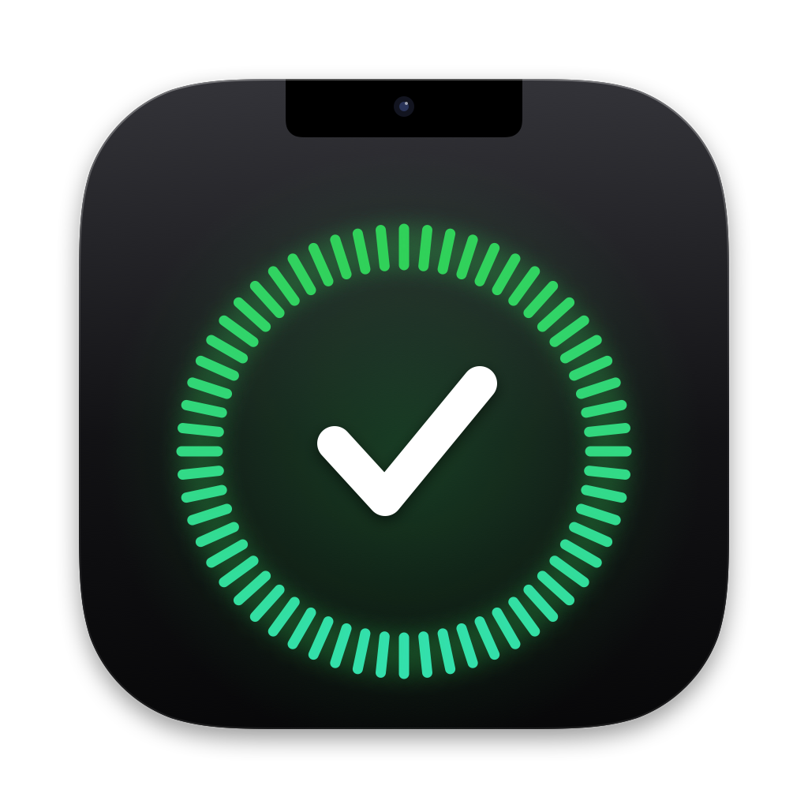
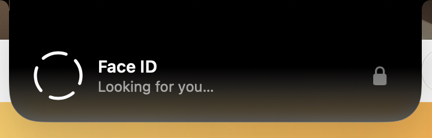
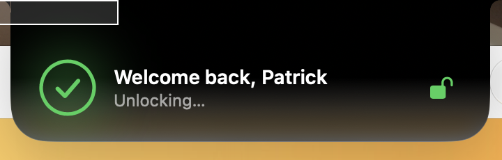
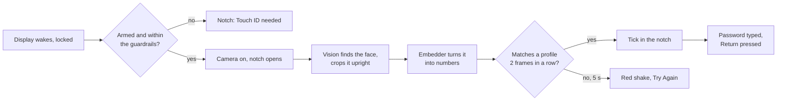

<p align="center">
  
</p>

<h1 align="center">WatchMyFace</h1>

<p align="center">
  <b>Face unlock for your Mac, right in the notch.</b><br>
  Wake your Mac, look at it, and you're in. The notch opens, looks for you, and turns into a tick.
</p>

<p align="center">
  <a href="https://github.com/Pallepadehat/WatchMyFace/actions/workflows/ci.yml"></a>
  
  
  <a href="LICENSE"></a>
</p>

<p align="center">
  
  
</p>

> [!WARNING]
> **WatchMyFace is a convenience, not a security upgrade.** A Mac's camera sees in 2D, without the depth sensor that
> makes Face ID safe, so a good lookalike, photo or video of you could fool it. And because macOS has no way for an app
> to approve a login, it unlocks by typing your password into the lock screen. Read
> [how it keeps your password safe](docs/SECURITY-MODEL.md) before you set it up.

## Features

**Lives in the notch.** The panel grows out of the camera housing with Dynamic Island–style springs: solid black where
it meets the housing, melting into clear Liquid Glass below. The Face ID glyph bends into a spinning ring while it
looks, closes into a green tick and opens the padlock when it's you ("Welcome back"), and shakes its head when it isn't.
Hover over the notch to try again. On Macs without a notch, it
floats as an island at the top of the screen.

**Works on the lock screen.** Wake your Mac (open the lid, press a key) and it starts looking. It shows on the real lock
screen, above everything.

**Set up like Face ID.** Move your head slowly to complete the circle: the camera in a ring of ticks that turn green as
you look around. Add more appearances (glasses, a beard, someone you trust) any time.

**Guardrails, like face unlock on iPhone.**
- It only works after a recent Touch ID: one touch arms it, after each launch.
- Your Mac sat locked for 45 minutes (you choose)? Type your password once, then Touch ID turns it back on.
- Five missed scans in a row, or two days since Touch ID, and it stops too.
- When it stops, your password leaves memory right away.

**Private.** Faces are kept as numbers, never pictures, in an encrypted file. Frames are read in memory and thrown
away. Nothing leaves your Mac: the only network request is Sparkle's update check.

**Fast.** The camera only runs while it's looking, and a scan needs only two matching frames once you're in view.

**Keeps itself up to date** with [Sparkle](https://sparkle-project.org), from signed releases on GitHub.

## Install

```sh
curl -fsSL https://raw.githubusercontent.com/Pallepadehat/WatchMyFace/main/install.sh | bash
```

Or download `WatchMyFace.dmg` from the [latest release](https://github.com/Pallepadehat/WatchMyFace/releases/latest)
and drag the app to Applications.

Setup opens on first launch:

1. **Permissions.** Camera, to see you, and Accessibility, to type your password into the lock screen.
2. **Face scan.** Roll your head in a slow circle until the ring is green.
3. **Password.** Your Mac's login password, checked on the spot so a wrong one is never typed.

Then lock your Mac (⌃⌘Q), wake it, and look at it.

Requires macOS 26 or later. Best on a MacBook with a notch; works with any camera, including Continuity Camera.

## How it works



Matching compares each frame with your enrolled profiles. Each profile's threshold comes from how alike its own
enrollment samples were, so it adapts to your face and camera. Out of the box it uses Apple's Vision feature print;
for sharper recognition you can [add a face-recognition model](tools/README.md).

More in [docs/ARCHITECTURE.md](docs/ARCHITECTURE.md).

## Building

Open `WatchMyFace.xcodeproj` in Xcode 27 or later and press **⌘R**. No developer team needed, but see
`Config/Local.xcconfig.example`: macOS ties the camera and Accessibility permissions to the app's signature, so a
team-signed build keeps them across rebuilds, and an ad hoc one asks again every time.

```sh
./scripts/check.sh   # lint, FaceKit tests, warning-free builds
./scripts/build.sh   # build/WatchMyFace.app
```

To work on the notch without locking your Mac, run with `--demo-notch`: it plays every state on a loop.

## Contributing

Pull requests are very welcome, into `develop`. Start with [CONTRIBUTING.md](.github/CONTRIBUTING.md).

## Thanks

- [glance](https://github.com/jonnyoo/glance) by Jonathan Zhou (MIT): the idea of face unlock in the notch, the notch's
  silhouette and springs, and the lock screen keystrokes.
- [SkyLightWindow](https://github.com/Lakr233/SkyLightWindow) by Lakr233 (MIT): drawing a window on the lock screen.
- [Sparkle](https://sparkle-project.org), for updates.

## License

[MIT](LICENSE). WatchMyFace isn't affiliated with Apple. Face ID, Touch ID and MacBook are Apple's trademarks.
