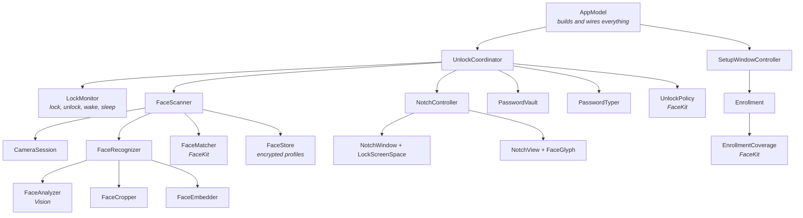

# Architecture

WatchMyFace is a menu bar app (`LSUIElement`) in SwiftUI and AppKit, plus a small Swift package, FaceKit, for the
logic that can be tested without a camera.

## The pieces

## A scan, step by step

1. **LockMonitor** hears the display wake (`NSWorkspace.screensDidWakeNotification` and friends) and the
   coordinator confirms the screen is really locked with the window server (`CGSessionCopyCurrentDictionary`), since
   anyone can post the lock notifications.
2. **UnlockCoordinator** checks the guardrails (`UnlockPolicy`) and that the vault is armed. If not, the notch shows
   "Touch ID" and that's it.
3. **NotchController** shows the scanning state. The window joins a private SkyLight space at Notification Center's
   lock screen level (`LockScreenSpace`), which is the only way to draw above the lock screen.
4. **FaceScanner** starts the camera. Each frame goes, on the camera's queue, through:
   - `FaceAnalyzer`: Vision's face landmarks, giving the box, the head's yaw, pitch and roll, and eye openness;
   - `FaceCropper`: a square around the face, turned upright, at the embedder's size;
   - `FaceEmbedder`: the crop as a unit vector;
   - `FaceMatcher`: the closest profile and whether it clears that profile's threshold.

   Frames that arrive while one's being read are dropped, so it never falls behind. Two frames in a row must match the
   same profile (`MatchStreak`), and, if asked, the eyes must blink (`BlinkDetector`).
5. On a match the notch plays the tick, `PasswordTyper` types the password at the HID event tap and presses Return,
   and the notch closes back into the housing.

## Thresholds that adapt

Embedders differ a lot in how far apart they put two people. Apple's Vision feature print is general purpose and puts
everyone fairly close; a face-recognition model spreads people far apart. So there's no single number. Each
`FaceProfile` measures how alike its own enrollment samples are (`baseline`: the 20th percentile of each sample's
similarity to the centroid of the others), and the chosen sensitivity sets the threshold some way below that, never
below the embedder's floor. Both the profile's centroid and its closest sample must clear it.

## The notch

`NotchWindow` is created once, sized for the biggest state, and never resized: SwiftUI animates the shape inside it,
which is what keeps the springs smooth. `NotchShape` is a body with continuous bottom corners and small inverted top
corners, like the real housing. `NotchBackground` is solid black down to the housing's height, then fades into clear
Liquid Glass (`glassEffect(.clear)`). `FaceGlyph` plays segments of `Resources/FaceUnlock.json` with Lottie: frames
15–66 for scanning, 66–118 for the tick, frame 66 tinted red for a miss. The animation's own notch layer is hidden.

The window lets every click through. While it offers a retry, a 20 Hz timer checks whether the pointer is over the
notch, since a click-through window gets no mouse events of its own.

## Concurrency

The app target defaults to the main actor. Camera, Vision and Core ML work is `nonisolated` and runs on the camera's
queue; types that cross from there to the main actor are `Sendable` or carefully locked (`ScanSession`, `FrameGate`).
Typing the password runs detached, since it sleeps between keystrokes.
