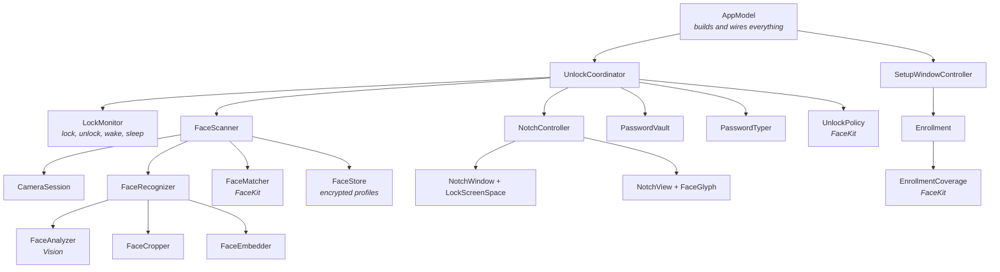

# Architecture

WatchMyFace is a menu bar app (`LSUIElement`) in SwiftUI and AppKit, plus a small Swift package, FaceKit, for the
logic that can be tested without a camera.

## The pieces

## A scan, step by step

1. **LockMonitor** hears the display wake (`NSWorkspace.screensDidWakeNotification` and friends) and the
   coordinator confirms the screen is really locked with the window server (`CGSessionCopyCurrentDictionary`), since
   anyone can post the lock notifications.
2. **UnlockCoordinator** checks the guardrails (`UnlockPolicy`) and that the vault is armed. If not, the notch shows
   "Touch ID" and that's it.
3. **NotchController** shows the scanning state. The window joins a private SkyLight space at Notification Center's
   lock screen level (`LockScreenSpace`), which is the only way to draw above the lock screen.
4. **FaceScanner** starts the camera. Each frame goes, on the camera's queue, through:
   - `FaceAnalyzer`: Vision's face rectangles (for the head's yaw and pitch), then landmarks, giving the box, five
     points (pupils, nose tip, mouth corners) and eye openness;
   - `FaceRecognizer`: skips frames that are no fair look at the face: pupils under 28 pixels apart, or, when
     unlocking, the head turned more than about 25° or tilted more than 20°;
   - `FaceCropper`: the five points moved onto the ArcFace template in a 112-pixel square (`FaceAlignment`, a least
     squares similarity fit), in colour; landmarks that don't fit a face's shape give no crop at all;
   - `FaceEmbedder`: the crop through SFace (Core ML) as a 128-number unit vector;
   - `FaceMatcher`: the closest allowed profile, whether it clears that profile's threshold, and whether a blocked
     profile is about as close (then it never passes).

   Frames that arrive while one's being read are dropped, so it never falls behind. Three frames in a row must match
   the same profile (`MatchStreak`), and, if asked, the eyes must blink (`BlinkDetector`).
5. On a match the notch plays the tick, `PasswordTyper` types the password at the HID event tap and presses Return,
   and the notch closes back into the housing.

## Setting up a face

`Enrollment` runs two circles with the head, like Face ID setup, with the face filling at least a fifth of the
frame's width (about half a metre from a MacBook's camera). Each frame's embedding goes to `SampleCollector` with
Vision's face capture quality, under its direction (`PoseBin`): up to 10 straight-ahead and 4 per direction, per
circle. A frame 0.97 alike to one already kept only replaces it if sharper; a full direction swaps out its blurriest.
The two circles' straight-ahead samples must agree (centroids at least 0.1 over the floor), and samples whose two
closest others are under 0.15 below the floor are dropped before the profile is saved.

## Thresholds that adapt

Each `FaceProfile` measures how alike its own enrollment samples are (`baseline`: the 20th percentile of each
sample's similarity to its two closest others), and the chosen sensitivity puts the threshold a share of the way from
the embedder's floor up to that baseline. A face is compared with the two samples closest to it, so a face turned a
little left is compared with the samples taken turned left.

The floor is 0.55 cosine similarity for SFace. Through this same pipeline, on official portraits, the same person
scored 0.65 to 0.99, a father and son 0.33 to 0.49, brothers 0.29 to 0.48, and strangers 0 to 0.41.

**Blocked profiles** are the backstop for a relative or lookalike who still gets close: a face whose similarity to a
blocked profile comes within 0.05 of its similarity to an allowed one is turned away, so the closer one wins.

## The face model

The app ships SFace, a MobileFaceNet trained with the SFace loss (99.4% on LFW), from the OpenCV Model Zoo under
Apache 2.0. `tools/convert_sface.py` downloads the ONNX file, checks its hash, converts it through PyTorch to a Core
ML program with float16 weights, and checks the result against ONNX Runtime. Its first layers subtract 127.5 and
divide by 128, so it takes plain RGB pixels. If it ever fails to load, `UnavailableEmbedder` takes its place and
nothing matches: face unlock never falls back to something weaker.

## The notch

`NotchWindow` is created once, sized for the biggest state, and never resized: SwiftUI animates the shape inside it,
which is what keeps the springs smooth. `NotchShape` is a body with continuous bottom corners and small inverted top
corners, like the real housing. `NotchBackground` is solid black down to the housing's height, then fades into clear
Liquid Glass (`glassEffect(.clear)`). Below the housing sits a row like the Now Playing panel's: the Face ID glyph, a
title and subtitle, and a padlock that springs open on success.

`FaceIDGlyph` is drawn in SwiftUI, not played from a file. Its four brackets are pieces of one rounded-square outline,
centered on the corners. A rounded square whose corner radius is half its side is a circle, so animating the radius
turns the face's brackets into the arcs of a spinner, and lengthening the pieces to a quarter each closes the ring
before the tick draws itself. A miss turns it back into the face, which shakes its head.

The window lets every click through. While it offers a retry, a 20 Hz timer checks whether the pointer is over the
notch, since a click-through window gets no mouse events of its own.

## Concurrency

The app target defaults to the main actor. Camera, Vision and Core ML work is `nonisolated` and runs on the camera's
queue; types that cross from there to the main actor are `Sendable` or carefully locked (`ScanSession`, `FrameGate`).
Typing the password runs detached, since it sleeps between keystrokes.
